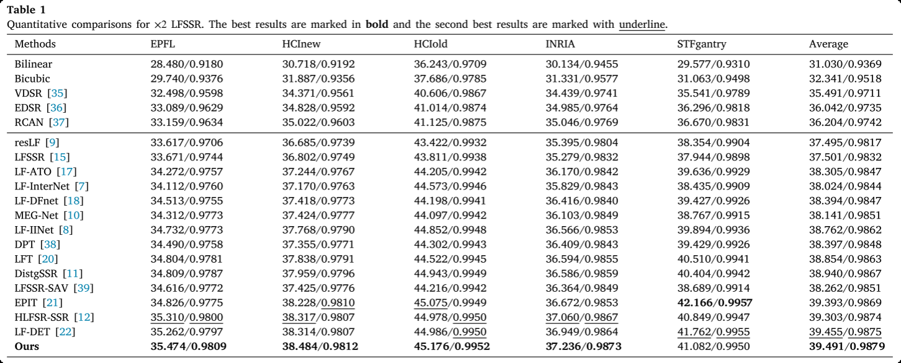
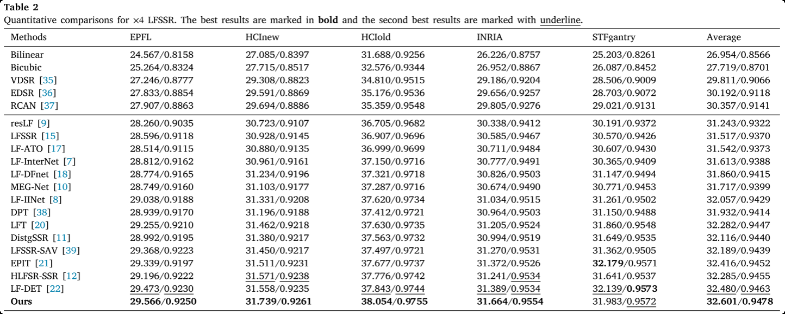
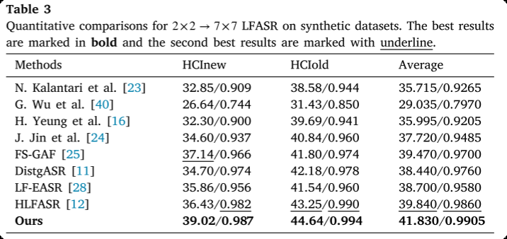
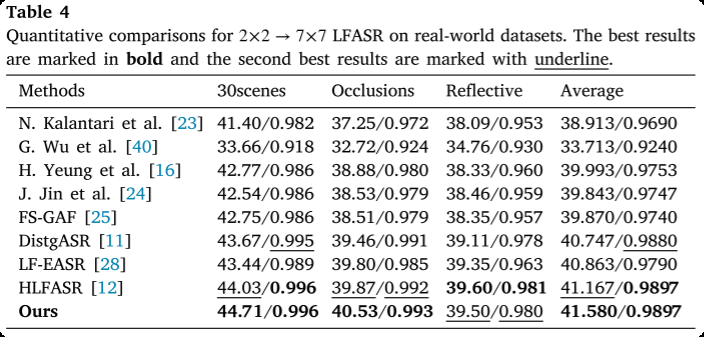

# Cascade Residual Learning based Adaptive Feature Aggregation for Light Field Super-Resolution
This is the official PyTorch implementation of the paper "Cascade Residual Learning based Adaptive Feature Aggregation for Light Field Super-Resolution" accepted in Pattern Recognition, 2025.

## Code

- **[AFA-LFSSR](https://github.com/haozhang25/AFA-LFSSR)**: Cascade Residual Learning based Adaptive Feature Aggregation for Light Field Spatial Super-Resolution<br> 


 <br><br>
- **[AFA-LFASR](https://github.com/haozhang25/AFA-LFASR)**: Cascade Residual Learning based Adaptive Feature Aggregation for Light Field Angular Super-Resolution<br> 
<p align="center">
  
  
</p>
  
## Citation
If you find this work helpful, please consider citing the following papers:<br> 
```Citation
@article{zhang2025cascade,
  title={Cascade residual learning based adaptive feature aggregation for light field super-resolution},
  author={Zhang, Hao and Zhou, Wenhui and Lin, Lili and Lumsdaine, Andrew},
  journal={Pattern Recognition},
  volume={165},
  pages={111616},
  year={2025},
  publisher={Elsevier}
}
```